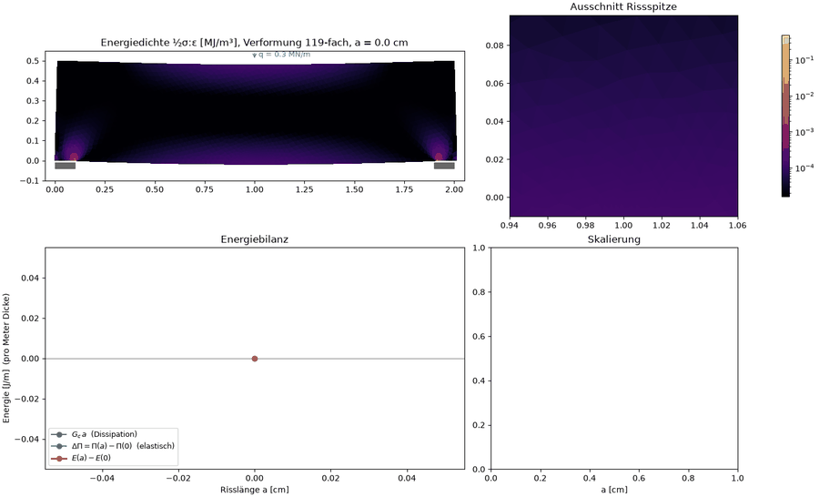
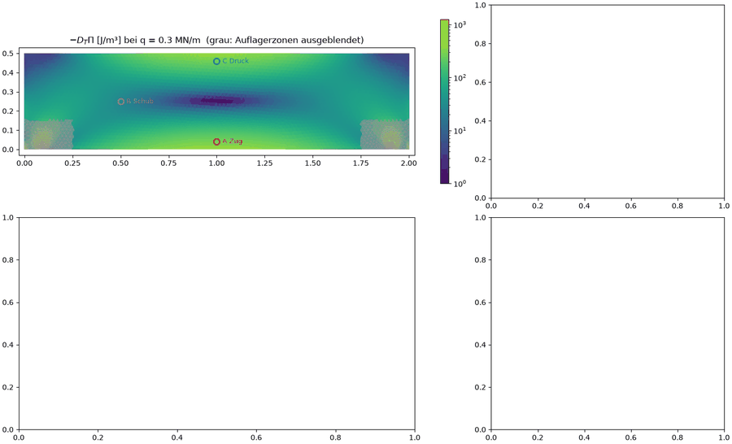

# Masterarbeit Bruchmechanik

Rissbildung über die **topologische Ableitung** (Riss als 3D-Teilvolumen) und
**Stahlbetonträger** als 3D-Volumenkörper mit 1D-Bewehrung, regularisiert über die
**Strain-Gradient-Theorie**. Betreuer: Prof. M. Gfrerer (TU Graz, Institut für Baumechanik).

Framework: **FEniCSx (DOLFINx 0.11)** mit PETSc/MUMPS. Es war im Benchmark des Masterprojekts das schnellste Framework für
Elastizität und koppelt 3D-Volumen und 1D-Stäbe nativ über Ridge-Integrale (`ufl.dr`).

## Bisherige Ergebnisse

### Griffith-Energie aus der Besprechung (`snippets/04_griffith_energy.py`)

$E(a) = \tfrac12\int_\Omega \sigma:\varepsilon\,dx + G_c\,a - W$ für einen 2D-Einfeldträger mit
Randriss der Länge $a$ in Feldmitte, für jede Risslänge neu vernetzt und gelöst.



- Der elastische Energiegewinn skaliert wie $-\Delta\Pi \sim a^2$. FEM und Rissbruchmechanik (LEFM) stimmen
  bis $a = 9$ cm auf 2–3 % überein.
- Energiebarriere bei $a^* \approx 12$ cm, $E(a) < E(0)$ ab $a_c \approx 19{,}8$ cm.
- $\dfrac{E(a)-E(0)}{a^2} = \dfrac{G_c}{a} - C \to +\infty$: Mit einer Dissipation proportional zu $a$
  entsteht aus dem intakten Zustand kein Riss. Das motiviert den Riss als Volumen.

### Riss als Volumen: topologische Ableitung (`snippets/05_topological_derivative.py`)

Die geschlossene Formel $D_T\Pi = -P_\gamma\,\sigma:\varepsilon$ (Xavier et al., Gl. 3.3–3.4) wird gegen
eine finite Störung geprüft: kleiner weicher Kreis ($\rho_0 = 10^{-6}$) mit Radius $\varepsilon \to 0$
in Zug-, Schub- und Druckzone. Danach folgt ein Schritt von Algorithmus 1 mit $\kappa_\delta = G_c/\delta$.



- Formel bestätigt: relativer Fehler $\sim\varepsilon^2$, bis 0,2 %. Es gelten die Lamé-Konstanten
  des ebenen Verzerrungszustands.
- Nukleation ab $q_c \approx 4{,}9\,q$ unten in Feldmitte (δ = 1 cm). $\omega^\beta$ ist mit $\pi\delta^2/4$ aufgelöst.
- Offen: Die Druckzone ist fast gleich „attraktiv“ wie die Zugzone (Francfort-Marigo unterscheidet nicht),
  die Auflagerkanten sind singulär (ausgeblendet), das Maximum liegt am Rand.

## Ordnerstruktur

```
README.md            dieses Dokument
environment.yml      conda-Umgebung (einzige Quelle für Versionen)
organisation/        Besprechungen (Scans + Abschrift), Zeitplan
literatur/           pdf/ + literature.bib (wird von thesis/ mitbenutzt)
vorarbeiten/         Masterprojekt (PDF) und codeBaseStiffener (FreeFEM), nur lesen
theory/              Herleitungen (Markdown/SymPy)
src/bruchmechanik/   gemeinsamer Code
  beam2d.py            2D-Einfeldträger: Netz (gmsh), Lösen, Plot-Hilfen
  topological_derivative.py   Polarisationstensor und D_T Pi nach Xavier et al.
meshes/              Gmsh-Generatoren (*.py); erzeugte *.msh werden nicht versioniert
snippets/            Machbarkeitstests und Studien, einzeln lauffähig
cases/               ein Ordner je Modellproblem
  01_mode1_2d/         Kalibrierung gegen Xavier et al., Abschn. 5.1 (2D, Mode I)
  02_beam_crack_3d/    Riss als 3D-Teilvolumen im Biegebalken
  03_rc_beam_3d1d/     Beton 3D + Bewehrung 1D, Strain Gradient
tests/               pytest
results/raw/         Rohdaten und Bilder je Lauf, nicht versioniert
results/curated/     kuratierte CSV, versioniert
scripts/             Auswertung; export_readme_media.py kopiert die GIFs nach docs/media/
docs/media/          Bilder für dieses README (versioniert)
thesis/              LaTeX
```

## Quickstart

```bash
mamba env create -f environment.yml      # einmalig
conda activate bruchmechanik
cd snippets
python 00_check_env.py                   # Umgebung prüfen
python 01_rebar_3d1d.py                  # 3D-Beton + 1D-Bewehrung (ufl.dr)
python 02_strain_gradient.py             # Strain Gradient, C0-Interior-Penalty
python 03_local_refinement.py            # lokale 3D-Verfeinerung
python 04_griffith_energy.py             # Griffith-Energie, live
python 05_topological_derivative.py      # topologische Ableitung, live
cd .. && python -m pytest tests          # Tests
python scripts/export_readme_media.py    # README-GIFs nach neuem Lauf aktualisieren
```
